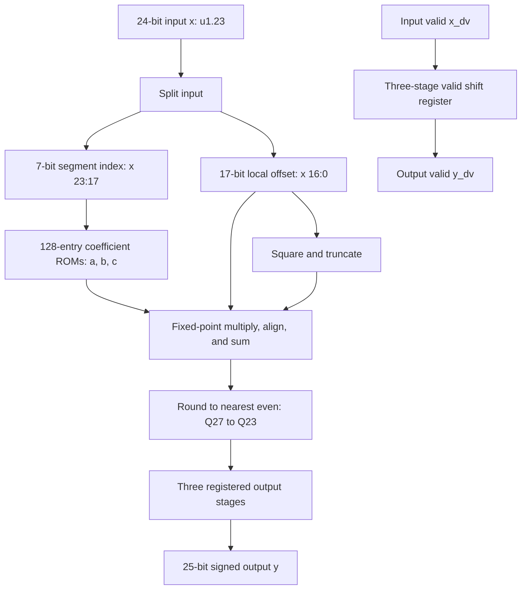

# Fixed-Point Quadratic Function Approximation Accelerator

[](https://github.com/kalemaarthur/quadratic-interolator/actions/workflows/CI.yaml)

A **SystemVerilog implementation of a piecewise-quadratic function approximator**, with independent C++ and Python reference models and automated RTL simulation. This project explores fixed-point arithmetic, coefficient lookup tables, rounding, hardware verification, and approximation-error optimization.

**Target function**

$$
f(x) = \sin(2x - \pi/4), \quad 0 \leq x < 2
$$

The input is an **unsigned 24-bit u1.23** value; the output is a **signed 25-bit s2.23** value. The range is divided into **128 segments**, with one quadratic polynomial and three stored coefficients per segment.

## Highlights

- Synthesizable SystemVerilog arithmetic datapath and top-level registered output chain.
- **128-entry lookup tables** for each coefficient (`a`, `b`, and `c`).
- Local polynomial evaluation: `y ≈ a + b·δ + c·δ²`.
- Fixed-point alignment, truncated intermediate products, and round-to-nearest-even output conversion.
- Three registered output stages with corresponding `x_dv` / `y_dv` valid signaling.
- Icarus Verilog simulation, GTKWave waveform generation, and self-checking Python verification.
- Independent C++ reference-model accuracy testing and C++–RTL output comparison.
- GitHub Actions workflow for RTL simulation and Python verification.

## Architecture



The **quadratic arithmetic is combinational** within `quadra.sv`; `quadra_top.sv` registers its result through three stages. These should not be confused with three internally pipelined arithmetic stages.

## Fixed-point representation

| Quantity | Representation | Notes |
|---|---|---|
| Input `x` | Unsigned u1.23, 24 bits | Domain `[0, 2)` |
| Segment index | 7 bits | `x[23:17]`, 128 segments |
| Local offset | 17 bits | `x[16:0]` |
| Coefficient `a` | Signed s1.22, 23 bits | Constant term |
| Coefficient `b` | Signed s3.16, 19 bits | Linear term |
| Coefficient `c` | Signed s2.10, 12 bits | Quadratic term |
| Internal sum | Signed, 29 bits, 27 fractional bits | Additional precision for rounding |
| Output `y` | Signed s2.23, 25 bits | Round-to-nearest-even |

The index and local offset select and evaluate one quadratic polynomial for each interval of width `1/64`.

## Accuracy improvement

The coefficient-generation script uses **three-point quadratic interpolation** (start, midpoint, and end of each segment), while retaining the existing RTL datapath and coefficient widths.

| Metric | Original coefficients | Optimized coefficients |
|---|---:|---:|
| Maximum absolute error on the same 2,048-vector verification set | `5.16705e-6` | `4.73330e-7` |
| Inputs failing `2.15e-6` tolerance | 331 / 2,048 | 0 / 2,048 |

This is approximately a **90.8% reduction in maximum sampled error** for that test set. These are **sampled results**, not a mathematical bound over all 16,777,216 possible inputs.

## Verification results

Latest local verification (20 November 2026):

| Check | Result |
|---|---|
| SystemVerilog vs. bit-exact Python model | **PASS — 0 mismatches / 2,048 vectors** |
| C++ vs. SystemVerilog (25-bit output words) | **PASS — 0 mismatches / 2,048 vectors** |
| C++ numerical testbench | **PASS — 65,281 sampled inputs** |
| Maximum sampled RTL error vs. mathematical sine | **4.73330073e-7** |
| Error tolerance | `2.15e-6` |

The 2,048-vector RTL suite includes fixed values, lookup-table boundary cases, and reproducible seeded random inputs. Signed outputs are compared as **25-bit words** to avoid misinterpreting 32-bit sign extension as a mismatch.

**Scope:** These tests validate numerical behavior for the sampled inputs. FPGA synthesis, resource utilization, maximum clock frequency, and physical-board measurements have **not** been established by these tests.

## Requirements

- Linux (Ubuntu or Windows Subsystem for Linux recommended)
- Python 3
- Icarus Verilog (`iverilog` and `vvp`)
- GNU Make
- G++ supporting C++17 (for the C++ model)
- **Algorithmic C Datatypes** headers (`ac_int.h`, `ac_fixed.h`) for C++ compilation, available separately
- Optional: GTKWave for viewing `.vcd` waveforms

On Ubuntu, install the general-purpose tools with:

```bash
sudo apt update
sudo apt install -y build-essential make python3 iverilog gtkwave
```

Install the Algorithmic C Datatypes headers separately if you want to build or compare the C++ model. The local Makefile's `compare` target expects them at `~/ac_types/include` by default, or you can override `AC_TYPES_INCLUDE`.

## Quick start

Clone the repository:

```bash
git clone https://github.com/kalemaarthur/quadratic-interolator.git
cd quadratic-interolator
```

Run the original SystemVerilog simulation (also writes `wave.vcd`):

```bash
make sim
```

Run the automated 2,048-vector RTL/Python verification:

```bash
make verify
```

To view waveforms on a system with a graphical display:

```bash
gtkwave wave.vcd
```

Build and run the independent C++ numerical testbench (requires Algorithmic C headers):

```bash
make -C c++-model
./c++-model/QuadraTb
```

Once the local `compare` Makefile target and `c++-model/compare_rtl.cpp` are committed, run the direct C++–RTL comparison using:

```bash
make compare
# Or: make compare AC_TYPES_INCLUDE=/path/to/ac_types/include
```

The `compare` target runs RTL verification, compiles the C++ comparison, and compares the output words recorded in `verification/results.csv`.

## Regenerate coefficient tables

Preview the original-versus-optimized approximation without changing files:

```bash
python3 verification/optimize_coefficients.py
```

Regenerate the optimized coefficient memory files and C++ coefficient header:

```bash
python3 verification/optimize_coefficients.py --apply
make verify
```

The script retains a backup of the original coefficients when applying the change for the first time.

## Repository structure

```text
.
├── Makefile                    # Local simulation and verification targets
├── a.mem, b.mem, c.mem          # Coefficient lookup-table memories
├── rtl-model/
│   ├── quadra_top.sv            # Output data/valid registers
│   ├── quadra.sv                # Combinational fixed-point datapath
│   ├── quadra.vh                # Fixed-point types and widths
│   ├── lut.sv                   # Coefficient ROM lookup
│   ├── square.sv                # Local offset squaring
│   └── quadra_tb.sv             # Waveform-producing simulation testbench
├── c++-model/                  # C++ approximation and numerical testbench
├── verification/
│   ├── verify_rtl.py            # 2,048-vector RTL/Python checker
│   ├── rtl_verify_tb.sv         # Self-checking test stimulus/output capture
│   └── optimize_coefficients.py # Coefficient generator/optimizer
└── .github/workflows/CI.yaml   # CI: RTL simulation and Python verification
```

## CI coverage

The current GitHub Actions workflow runs `make sim` and `make verify` on Ubuntu. The C++/RTL comparison is currently a **local** test because the external Algorithmic C Datatypes headers have not yet been provisioned in CI.

## Future work

- Extend the test suite to larger random and dense sweeps, or exhaustive verification of the 24-bit input space.
- Add a reproducible C++ dependency-installation process and the cross-model comparison to CI.
- Run FPGA synthesis to measure LUTs, flip-flops, memory inference, timing, and maximum frequency.
- Investigate true arithmetic pipelining and its frequency/latency tradeoffs.

## Project status

**Working, simulation-verified portfolio implementation.** The project demonstrates RTL design and sampled fixed-point verification; no physical FPGA deployment is claimed.


## Hardware Synthesis Results

The SystemVerilog design was successfully synthesized
using Yosys 0.33.

| Metric | Result |
|---|---:|
| Generic logic cells | 7,024 |
| Flip-flop cells | 78 |
| Wires | 6,898 |
| Wire bits | 7,623 |
| Top module | quadra_top |

The design uses a three-stage registered output pipeline
with 25-bit output data and a corresponding valid signal.

Run synthesis locally using:

`make synth`

These results represent generic technology-independent
logic cells. FPGA-specific LUT, DSP, BRAM utilization,
timing closure, and maximum clock frequency have not
yet been measured.
