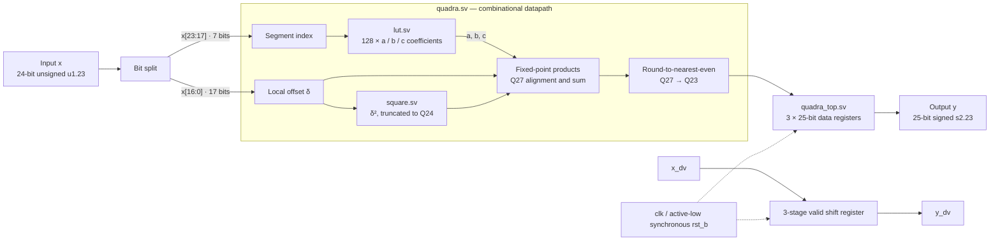

# Hardware Architecture — Fixed-Point Quadratic Approximation Accelerator

This document describes the implemented SystemVerilog architecture in `rtl-model/`. The design approximates

\[
f(x)=\sin(2x-\pi/4), \qquad 0\le x<2
\]

with a **piecewise quadratic**, fixed-point datapath. The arithmetic inside `quadra.sv` is **combinational**; the top-level `quadra_top.sv` provides three consecutive output register stages.

## Datapath diagram



## Signal and number formats

| Quantity | RTL representation | Meaning |
|---|---|---|
| `x` | 24-bit unsigned **u1.23** | Input over `[0, 2)` |
| `x1 = x[23:17]` | 7-bit unsigned | Selects one of 128 quadratic segments |
| `x2 = x[16:0]` | 17-bit unsigned | Local position within segment; numerical offset is `x2 / 2^23` |
| `a` | 23-bit signed **s1.22** | Constant coefficient |
| `b` | 19-bit signed **s3.16** | Linear coefficient |
| `c` | 12-bit signed **s2.10** | Quadratic coefficient |
| `sq` | 24-bit unsigned **Q24** | Truncated local-offset square |
| `sum_q27` | 29-bit signed, 27 fractional bits | Aligned polynomial sum |
| `y` | 25-bit signed **s2.23** | Rounded approximation result |

Each segment covers a width of `2 / 128 = 1/64` in the input's real-valued domain. The lookup tables are loaded from `a.mem`, `b.mem`, and `c.mem` with `$readmemh`.

## Computation sequence

1. **Select the segment:** use `x[23:17]` to read the associated coefficients `a`, `b`, and `c`.
2. **Determine local position:** use `x[16:0]` for the local offset `δ`.
3. **Compute the quadratic term:** `square.sv` multiplies the local offset by itself and truncates the raw Q46 product to Q24.
4. **Evaluate the polynomial:** calculate the fixed-point equivalent of `a + b·δ + c·δ²`, aligning all terms to 27 fractional bits before addition.
5. **Round:** convert the Q27 sum to a signed Q23 result using convergent (round-to-nearest-even) rounding.
6. **Register the result:** `quadra_top.sv` passes data through `y_p0`, `y_p1`, `y_p2` and the corresponding valid bit through `dv_p0`, `dv_p1`, `dv_p2`. Both pipelines use a synchronous active-low reset.

**Pipeline interpretation:** The three data stages register the *already-computed combinational result*. They are not three separately pipelined arithmetic stages. The outputs correspond to the `x_dv` input sampled by the same clocked interface, with a three-register path.

## Verification evidence

Results reported from local runs on 20 November 2026:

| Check | Observed result |
|---|---|
| `make sim` | Icarus Verilog simulation completed |
| `make verify` | 2,048 vectors, **0 RTL/Python mismatches** |
| `make compare` | 2,048 vectors, **0 C++/RTL 25-bit mismatches** |
| C++ numerical testbench | **PASS**, 65,281 sampled vectors |
| Maximum sampled error against sine | **4.73330073e-7** |
| Allowed error in current verification | **2.15e-6** |

The validation is **sampled**, not an exhaustive proof over the entire 24-bit input space. The C++ comparison uses the lower 25 bits of signed results to avoid treating sign extension as an arithmetic mismatch.

## Generic synthesis evidence

A Yosys 0.33 generic synthesis of `quadra_top` produced:

| Statistic | Count |
|---|---:|
| Generic technology-independent logic cells | **7,024** |
| Flip-flop cells | **78** |
| Wires | **6,898** |
| Wire bits | **7,623** |

The 78 flip-flop cells are consistent with the top-level registers: **3 × (25 data bits + 1 valid bit)**.

These are *generic logic* statistics, **not** a target FPGA's LUT, DSP, BRAM, placement, routing, or timing results. No maximum clock frequency or physical-board performance is claimed.

## Reproduce locally

From the repository root:

```bash
make sim       # RTL testbench and VCD waveform
make verify    # 2,048-vector RTL/Python check
make compare   # C++/RTL cross-check; requires Algorithmic C Datatypes headers
make synth     # Yosys generic synthesis
```

For the C++ target, install the Algorithmic C Datatypes headers and set `AC_TYPES_INCLUDE` if they are not at `~/ac_types/include`.

## RTL source files

- `rtl-model/quadra_top.sv` — three-register output and valid pipelines
- `rtl-model/quadra.sv` — fixed-point quadratic evaluation, alignment, and rounding
- `rtl-model/lut.sv` — coefficient table interface
- `rtl-model/square.sv` — square and truncation
- `rtl-model/quadra.vh` — bit widths, signed types, and shift parameters
